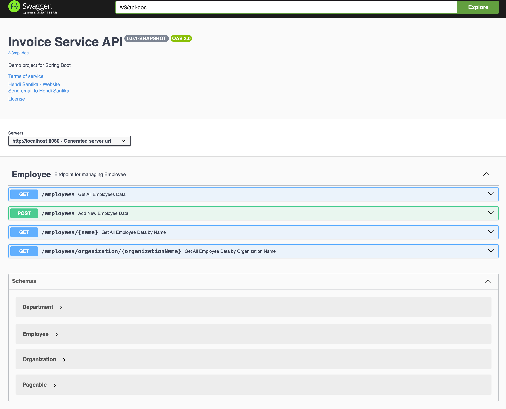

# spring-elasticsearch-sample

[](https://github.com/hendisantika/spring-elasticsearch-sample/actions/workflows/maven.yml)


Sample REST API built with **Spring Boot** and **Spring Data Elasticsearch** that stores and searches `Employee`
documents in Elasticsearch, documented with **Swagger UI (springdoc-openapi)**.

## Tech Stack

| Component                 | Version                           |
|---------------------------|-----------------------------------|
| Java (JDK)                | 25                                |
| Spring Boot               | 4.2.0                             |
| Spring Data Elasticsearch | managed by Spring Boot            |
| Elasticsearch             | 9.x                               |
| springdoc-openapi         | 3.2.1                             |
| Maven (wrapper)           | 3.9.11                            |
| Testing                   | JUnit 5, AssertJ, Testcontainers  |

## Prerequisites

- JDK 25
- Docker (to run Elasticsearch locally and for the Testcontainers based tests)
- Maven is optional, the project ships with the Maven Wrapper (`./mvnw`)

## Things todo list

1. Clone this repository:
   ```shell
   git clone https://github.com/hendisantika/spring-elasticsearch-sample.git
   ```
2. Navigate to the folder:
   ```shell
   cd spring-elasticsearch-sample
   ```
3. Make sure your Elasticsearch is UP & RUNNING. For example with Docker:
   ```shell
   docker run -d --name elasticsearch -p 9200:9200 \
     -e discovery.type=single-node \
     -e xpack.security.enabled=false \
     -e ES_JAVA_OPTS="-Xms512m -Xmx512m" \
     docker.elastic.co/elasticsearch/elasticsearch:9.5.6
   ```
4. Run the application:
   ```shell
   ./mvnw clean spring-boot:run
   ```
5. Open your favorite browser: http://localhost:8080/swagger-ui

## Configuration

The connection is configured in `src/main/resources/application.yml`:

| Property                 | Default          | Description                                                  |
|--------------------------|------------------|--------------------------------------------------------------|
| `elasticsearch.host`     | `localhost:9200` | Elasticsearch host & port                                    |
| `elasticsearch.username` | `elastic`        | Basic auth username                                          |
| `elasticsearch.password` | `changeme`       | Basic auth password                                          |
| `initial-import.enabled` | `true`           | Import 10.000 random sample employees on application startup |

Any property can be overridden on the command line, e.g.:

```shell
./mvnw spring-boot:run -Dspring-boot.run.arguments="--initial-import.enabled=false --elasticsearch.host=localhost:9200"
```

## API Endpoints

| Method | Path                                     | Description                            |
|--------|------------------------------------------|----------------------------------------|
| POST   | `/employees`                             | Add a new employee                     |
| GET    | `/employees?page=0&size=20`              | Get all employees (paginated)          |
| GET    | `/employees/{name}`                      | Find employees by name                 |
| GET    | `/employees/organization/{organization}` | Find employees by organization name    |

Sample request:

```shell
curl -X POST http://localhost:8080/employees \
  -H "Content-Type: application/json" \
  -d '{
        "name": "Uzumaki Naruto",
        "age": 17,
        "position": "Developer",
        "department": { "id": 1, "name": "TestD" },
        "organization": { "id": 1, "name": "Konoha", "address": "Test Street No. 1" }
      }'
```

OpenAPI docs are available at http://localhost:8080/v3/api-doc.

## Running the Tests

The integration tests start a real Elasticsearch `9.5.6` container with [Testcontainers](https://testcontainers.com),
so you only need Docker running — no local Elasticsearch is required.

```shell
./mvnw verify
```

## CI/CD & Dependency Updates

- **GitHub Actions** (`.github/workflows/maven.yml`) builds and tests the project on JDK 25 (Temurin) for every push
  and pull request to `master`, and submits the Maven dependency graph to GitHub on pushes to `master`.
- **Dependabot** (`.github/dependabot.yml`) checks Maven dependencies daily and GitHub Actions weekly. Updates are
  grouped (Spring Boot, springdoc, Maven plugins, minor & patch, GitHub Actions) and labelled to keep the PR noise low.

> The Elasticsearch Docker image version used by the tests lives in `AbstractElasticsearchContainerTest` and is not
> tracked by Dependabot — bump it together with the Spring Boot (Elasticsearch client) version.

## Image Screenshot

Swagger UI Page


